  

# Hi there, I'm definitelynotDD! 👋

> _"Coding, clouding, and always blocking my own chain of procrastination."_ 😄

By day I work full time handling databases and automating legacy tasks (someone has to teach old processes new tricks). After hours I volunteer with Gyaandweep and Frevo Technologies, building AI tools for the love of it and to keep up with the latest in AI. BTech CSE grad (2026), Python by default, and I deploy to the cloud whenever a project deserves to outlive my laptop.

- 💬 **Ask me about:** RAG-based AI bots, AI workflows, database work, and automating legacy tasks
- 🤝 **Open to:** collaborating on Python, AI/ML, or cloud projects

## 🥅 Goals Scored (What I've Built)
- **[Gyaandweep](https://gyaandweep.com):** Worked extensively on library enrichment and built the platform's own personalised Acharya AI.
- **[Frevo Technologies](https://www.frevotechnologies.in/):** Built the TenderTrack AI workflow end to end. Organisations can find and analyse tenders and run their entire approval system in one place.

## 🏟️ Team Sheet (Tech Stack)
| Position | Lineup | Scouting report |
|---|---|---|
| 🧤 Goalkeeper | Databases | Handling them full time at my day job, so they don't handle me |
| 🛡️ Defence | Automation | Automating legacy tasks, also part of the day job |
| 🎯 Midfield | Python (captain), Java, JavaScript | Python runs the game; the other two step in when needed |
| 🏃 Wings | HTML, CSS, JavaScript | Web dev down the flanks, with a sprinkle of frameworks |
| ⚡ Attack | AI/ML | RAG-based AI bots and AI workflows, always trying out new models |
| 🏠 Home ground | Cloud | Deploying dreams, one VM at a time |
| 🪑 Bench | Blockchain | Dabbled in it, mostly learning how not to lose my crypto |

## 📣 Pass Me the Ball
- [LinkedIn](https://www.linkedin.com/in/devanshu-das)

## ⏱️ Extra Time (Fun Facts)
- You'll find me on the football field when I'm not debugging.
- I love reading short novels – it's the only time I finish something in one sitting!

---

**📺 Live score:** definitelynotDD 1 – 0 Legacy Code · 90+4' · still pressing

> _“Eat, sleep, code, football, repeat. And occasionally, I read the docs.”_
